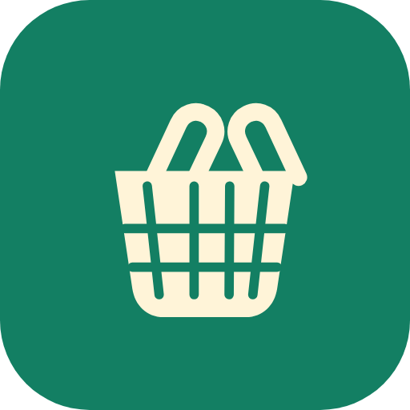

<p align="center">
   
</p>

# Korb

A self-hosted shopping list with a Bring-style interface, Alexa list import, user accounts, and optional two-factor authentication. Active Alexa items are saved locally before being removed from Amazon; duplicate items are combined and quantities are counted. Remote access through Tailscale Funnel is optional. Developed with assistance from GitHub Copilot. Third-party asset notices are in [NOTICE](NOTICE).

## Requirements

- Docker Compose v2 and access to `ghcr.io/partofthecurse/korb`.
- An Amazon account with an Alexa shopping list and a TOTP authenticator seed.
- Optional remote access: a Tailscale account with Funnel enabled, MagicDNS, and a reusable auth key permitted to create the Funnel node.

## Installation

1. Copy `compose.yaml` and `.env.example` to a folder on your Docker host. Copy `.env.example` to `.env`, set `SHOPPING_IMAGE=ghcr.io/partofthecurse/korb:latest`, and choose `SHOPPING_BIND_ADDRESS`. The default `127.0.0.1` exposes the app only on the Docker host; use the host's LAN address for home-network access.
2. Create the first admin account:

   ```sh
   docker compose run --rm --no-deps --entrypoint python shoppinglist -m shoppinglist.manage create-admin
   ```

3. Start the app:

   ```sh
   docker compose up -d
   ```

4. Open `http://<SHOPPING_BIND_ADDRESS>:32768`, sign in, then enter your Amazon region, email, password, and TOTP seed under **Amazon**. Credentials and refresh session are encrypted in SQLite. Active Alexa items sync at startup and every five minutes, then are removed from Amazon after local storage.
5. To enable remote HTTPS access, set `TS_HOSTNAME`, `TS_CERT_DOMAIN`, and `TS_AUTHKEY_SECRET_FILE` in `.env`, store the reusable key in `secrets/tailscale_authkey`, and protect both files with `chmod 600`. Copy `compose.tailscale.yaml` and `config/`, then run:

   ```sh
   docker compose -f compose.yaml -f compose.tailscale.yaml up -d
   ```

   Funnel is public to the internet; app login remains required. Once HTTPS is active, install the PWA with **Install app** in Android Chrome or **Share → Add to Home Screen** in iOS Safari.

To update after a new release, run `docker compose pull && docker compose up -d`.

## Notices

- Food icons: Twemoji by Twitter, Inc. and contributors, licensed under [CC BY 4.0](https://creativecommons.org/licenses/by/4.0/); distributed via [`@twemoji/svg`](https://www.npmjs.com/package/@twemoji/svg), which is MIT-licensed.
- Fonts: DM Sans by The DM Sans Project Authors and Outfit by The Outfit Project Authors, both licensed under the [SIL Open Font License 1.1](https://openfontlicense.org/). License files are included with the fonts.
- GitHub Copilot provided AI-assisted development assistance. See [NOTICE](NOTICE) for the corresponding asset notices.
